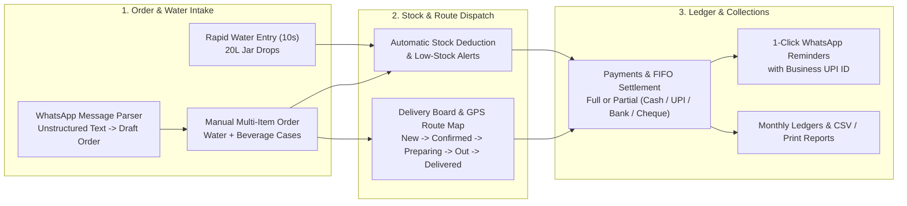

# Business Overview — Ocean Enterprises

## 1. Company Profile & Operational Reality

**Ocean Enterprises** is a water supply and wholesale beverage distribution enterprise based in Jogeshwari (West), Mumbai (`Muntaha Building, JVLR Road, Jogeshwari (West), Mumbai - 400102`).

The business operates two tightly coupled distribution lines:
1. **Packaged Drinking Water Supply**:
   - High-frequency daily delivery of **20L Refillable Water Jars**, **1L Water Bottles (12-pack boxes)**, and **500ml Water Bottles (24-pack boxes)**.
   - Customers receive water jars daily or multiple times per week and typically settle their accounts either immediately in cash/UPI or on a running monthly ledger.
2. **Wholesale Cold Beverage Distribution**:
   - Bulk case and carton supply of branded beverages including **Frooti** (`1.2L`, `600ml`, `300ml`, `160ml`), **Appy Fizz** (`600ml`, `250ml`), **Thums Up** (`750ml`), **B Fizz** (`250ml`), **Smoodh Chocolate Milk** (`85ml`), **Litchi Juice** (`250ml`), and **Guava Drink** (`250ml`).

---

## 2. Customer Segments Served

The system categorizes every customer account (`customers.customer_type`) into one of four real-world segments:

| Segment | Typical Order Pattern | Billing & Settlement Pattern |
| :--- | :--- | :--- |
| **Restaurant** | High daily volume of 20L water jars + multi-case beverage restocks | Running credit ledger settled weekly or monthly via UPI / Bank Transfer / Cash |
| **Office** | Recurring daily or alternate-day 20L water jar drops | Monthly consolidated statement and bank/UPI settlement |
| **Shop** | Mixed wholesale orders of Frooti, Appy Fizz, Thums Up, and 1L/500ml water boxes | Cash on delivery, partial counter payment, or short-term credit |
| **Residential** | Small 20L water jar deliveries (1–5 jars per drop) | Instant Cash/UPI or monthly jar tally |

---

## 3. Core Business Workflows & Software Mapping

### Workflow 1: Customer Registration & Geolocation Pinning
- **Business Need**: Delivery drivers in Mumbai often navigate dense commercial lanes where text addresses alone are ambiguous.
- **How the Software Supports It**:
  - Each customer record stores `name`, `business_name`, `phone`, `whatsapp_number`, `address`, `customer_type`, `notes`, and optional GPS coordinates (`latitude`, `longitude`).
  - Operators or drivers on mobile devices can click **Capture Live Phone GPS** (`navigator.geolocation.getCurrentPosition`) when adding or editing a customer, or use `POST /api/customers/:id/location` to pin exact shop coordinates.

### Workflow 2: Catalog & Warehouse Inventory Management
- **Business Need**: Track available stock of water jars and beverage packs, monitor purchase cost vs. selling price margins, and prevent stockouts of fast-moving SKUs.
- **How the Software Supports It**:
  - Every product in the `products` table tracks `category` (`Water` or `Beverage`), `size`, `selling_price`, `purchase_price`, `stock`, `minimum_stock`, and `active` status.
  - Whenever an order (`POST /api/orders`) or a rapid water entry (`POST /api/water`) is recorded, product stock is automatically decremented (`MAX(0, stock - quantity)`).
  - If an order is **Cancelled** (`PUT /api/orders/:id/status` or `PUT /api/deliveries/:id/status`) or **Deleted** (`DELETE /api/orders/:id` or `DELETE /api/water/:id`), the software automatically restores the exact item quantities back into product stock.
  - Products whose `stock <= minimum_stock` appear automatically in the Dashboard **Low Stock Alerts** panel and under the **Low Stock Only** filter in **Inventory & Stock**.

### Workflow 3: 10-Second Rapid Water Supply Entry
- **Business Need**: Logging dozens of daily 20L water jar deliveries must take under 10 seconds per stop without building a full multi-line sales order.
- **How the Software Supports It**:
  - The **Rapid Water Entry** screen (`WaterEntry.jsx`) pre-selects the default `20L Water Jar` rate (`₹35` per jar, editable per transaction) and provides tactile `+1`, `+2`, `+5`, `+10`, and `Reset` stepper buttons.
  - The operator selects the customer, taps the jar count, chooses `Pending (Add to Monthly Ledger)` or `Paid Instantly`, and clicks **SAVE WATER ENTRY**.
  - If marked `Paid`, a corresponding completed payment record is automatically created in `payments`.
  - Immediately after saving, a banner offers a 1-click **Send WhatsApp Slip** action that opens WhatsApp with a formatted receipt showing today's jar drop and the customer's updated total pending balance.

### Workflow 4: WhatsApp Order Parsing & Multi-Item Orders
- **Business Need**: Retail shops and restaurants frequently send informal text messages on WhatsApp such as `"Hotel Shalimar: 5 water jars, 3 Thums Up, 2 Frooti 600"`.
- **How the Software Supports It**:
  - The **WhatsApp Orders** screen (`WhatsAppOrders.jsx`) sends raw text to `POST /api/orders/parse-whatsapp`.
  - The parser matches customer names/business names/phone numbers against the `customers` directory and matches item segments against product keywords (`20l`, `water`, `jar`, `1l`, `500ml water`, `frooti 1.2`, `frooti 600`, `frooti 300`, `frooti 160`, `appy fizz`, `thums up`, `litchi`, `guava`), returning a confidence rating (`HIGH`, `MEDIUM`, or `LOW`), matched line items, and computed total.
  - With 1 click (**Accept & Create Order**), the system generates a sequential order number (`ORD-YYYY-XXXX`), inserts `orders` and `order_items`, deducts stock, and schedules a `deliveries` stop.

### Workflow 5: Delivery Dispatch & Route Sequencing
- **Business Need**: Track orders from warehouse preparation to van loading and doorstep delivery, and give drivers an ordered list of stops with map navigation.
- **How the Software Supports It**:
  - Every created order automatically generates a linked row in `deliveries` with `status = 'New Order'` and a `route_sequence` number.
  - Dispatchers use the **Deliveries** board (`Deliveries.jsx`) to reorder stops (Up/Down buttons calling `PUT /api/deliveries/reorder`) and update status across five active stages: `New Order` -> `Confirmed` -> `Preparing` -> `Out for Delivery` -> `Delivered` (plus `Cancelled`).
  - Status updates synchronize bi-directionally between `orders.delivery_status` and `deliveries.status`, stamping `delivered_at` upon completion.
  - The **Route Map** screen (`DeliveryRoute.jsx`) renders all stops with GPS coordinates on an interactive Leaflet map with numbered pins (`1`, `2`, `3`...), a connecting route polyline, and 1-click Google Maps directions.

### Workflow 6: Payments, Partial Settlements & FIFO Account Ledgers
- **Business Need**: Customers rarely pay exact invoice-by-invoice amounts; a restaurant with `₹1,200` in unpaid water entries and beverage orders may hand `₹500` cash to the driver or transfer `₹1,000` via UPI.
- **How the Software Supports It**:
  - Both `orders` and `water_entries` track `total_amount`, `paid_amount`, and `payment_status` (`Pending`, `Partial`, or `Paid`).
  - When recording a payment (`POST /api/payments`), the payment can target:
    1. A specific order (`order_id`),
    2. A specific water entry (`water_entry_id`), or
    3. The customer's general account (no `order_id` or `water_entry_id`), which executes inside a database transaction (`db.transaction`) using **FIFO allocation**:
       - First settles the customer's oldest unpaid/partial non-cancelled **orders** (`ORDER BY order_date ASC`).
       - Any remaining payment amount automatically settles the customer's oldest unpaid/partial **water entries** (`ORDER BY date ASC`), updating each entry to `Paid` or `Partial` and incrementing its `paid_amount`.
  - Customer pending balances (`balance_pending` / `pending_balance`) are dynamically computed from the sum of unpaid order balances (`total_amount - paid_amount` for non-cancelled orders) plus unpaid water entry balances (`total_amount - paid_amount`), ensuring the ledger is always mathematically consistent.

### Workflow 7: Reporting, Statements & Accounting Exports
- **Business Need**: Review daily/weekly/monthly revenue splits between Water Supply and Beverage Orders, audit customer receivables, and print or export statements.
- **How the Software Supports It**:
  - **Reports** (`Reports.jsx`) provides three analytical views:
    - **Sales Report** (`daily` for last 14 days, `weekly` for last 8 weeks, `monthly` for last 6 months) splitting `orderSales`, `waterSales`, and `totalSales`.
    - **Customer-wise Ledger Report** ranking customers by total sales with water jars consumed, order count, total billed, total paid, and pending balance.
    - **Product-wise Performance Report** showing units sold (combining order items and rapid water entries), revenue, purchase cost, and estimated profit (`revenue - units_sold * purchase_price`).
  - Every report and the customer detail modal supports **Export CSV** (`exportToCSV`) and **Print / Save PDF Statement** (`printStatement`).

---

## 4. Capabilities Not Currently Implemented (Planned / Out of Scope)

To maintain strict transparency between actual software capabilities and potential future enhancements:
- **Automated WhatsApp Cloud API Webhooks**: Inbound WhatsApp messages are pasted into the WhatsApp Order Parser UI rather than ingested automatically via Meta Cloud API webhooks; outbound messages open pre-filled `wa.me` links for the user to send.
- **Empty Jar Return Counter**: While delivery completion messages remind customers about empty jar pickup, the database does not currently maintain a separate `empty_jars_returned` inventory ledger per customer.
- **Multi-User Driver Accounts in UI**: The application operates as a unified operations workspace; separate restricted login portals per delivery driver are not currently enabled in the frontend UI.
- **Automated Algorithmic Route Optimization**: Route sequences are adjusted manually by the dispatcher (`PUT /api/deliveries/reorder`) rather than computed automatically via an external directions matrix API.

