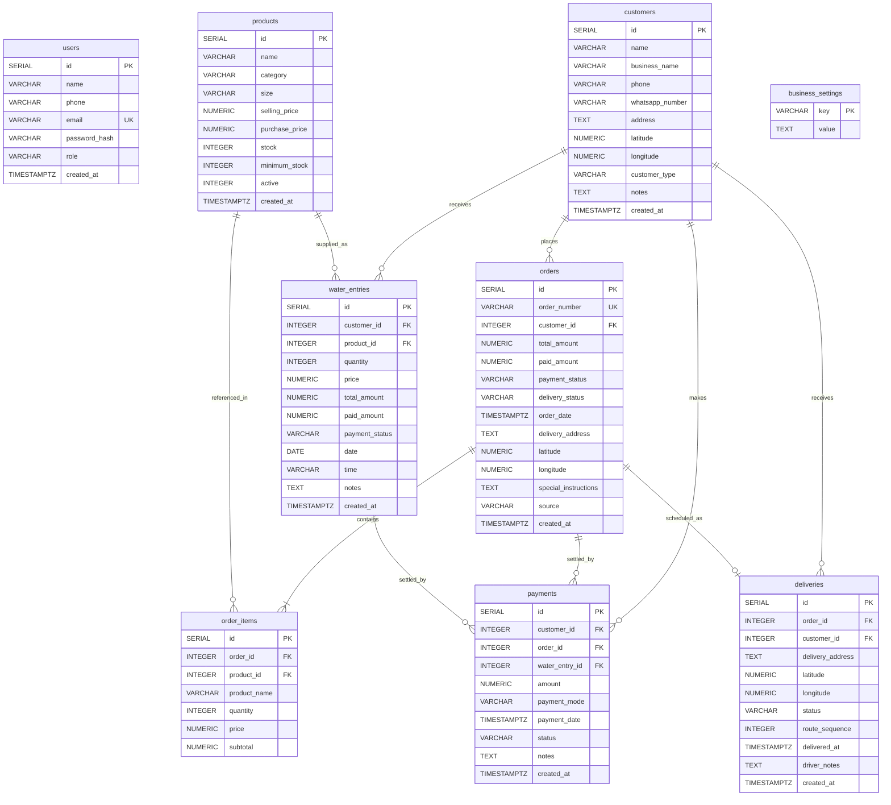

# Database Design

This document details the database schema, relationships, dual-mode storage adapter, transaction guarantees, and financial calculation formulas implemented in the **Ocean Enterprises Business Management System**.

---

## 1. Storage Architecture Overview

The application implements a dual-mode persistence layer in [`server/db/database.js`](../server/db/database.js) and [`server/db/postgres.js`](../server/db/postgres.js):

| Mode | Active When | Storage Engine | Durability & Use Case |
| :--- | :--- | :--- | :--- |
| **PostgreSQL Mode (Production)** | `DATABASE_URL` or `POSTGRES_URL` starts with `postgresql://` or `postgres://` | Managed PostgreSQL (Neon `neondb` in production) via `pg` connection pool | **Fully persistent, ACID transactional, multi-instance safe.** Verified in live production (`https://ocean-enterprises.vercel.app/api/health`). |
| **Local JSON Store Mode (Dev / Test Fallback)** | `DATABASE_URL` and `POSTGRES_URL` are unset | Local JSON file [`server/data/ocean_store.json`](../server/data/ocean_store.json) | **Persistent on local disk** for zero-setup local development and isolated unit testing. On serverless platforms without `DATABASE_URL`, falls back to `/tmp/ocean_store.json` (ephemeral across cold starts). |

> **Verification Note**: You can verify which storage engine is active in any environment by requesting `GET /api/health`. When PostgreSQL is active and connected, it returns `"storage": "postgresql"`, `"database_connected": true`, and `"persistent": true`.

---

## 2. Entity-Relationship Diagram

---

## 3. Relational Table Definitions (`server/db/schema.postgres.sql`)

### 3.1 `users`
Stores authenticated workspace operators and administrators.
- `id`: `SERIAL PRIMARY KEY`
- `name`: `VARCHAR(255) NOT NULL`
- `phone`: `VARCHAR(50)`
- `email`: `VARCHAR(255) UNIQUE NOT NULL` (Indexed via `idx_users_email`)
- `password_hash`: `VARCHAR(255) NOT NULL` (`bcryptjs` 10-round salt hash)
- `role`: `VARCHAR(50) DEFAULT 'admin'`
- `created_at`: `TIMESTAMPTZ DEFAULT CURRENT_TIMESTAMP`

### 3.2 `customers`
Stores commercial and residential client profiles and geolocation coordinates.
- `id`: `SERIAL PRIMARY KEY`
- `name`: `VARCHAR(255) NOT NULL`
- `business_name`: `VARCHAR(255)` (Indexed via `idx_customers_business`)
- `phone`: `VARCHAR(50) NOT NULL` (Indexed via `idx_customers_phone`)
- `whatsapp_number`: `VARCHAR(50)`
- `address`: `TEXT NOT NULL`
- `latitude`: `NUMERIC(10, 6)`
- `longitude`: `NUMERIC(10, 6)`
- `customer_type`: `VARCHAR(50) DEFAULT 'Shop'` (`Restaurant`, `Office`, `Shop`, `Residential`; indexed via `idx_customers_type`)
- `notes`: `TEXT`
- `created_at`: `TIMESTAMPTZ DEFAULT CURRENT_TIMESTAMP`

### 3.3 `products`
Stores water and beverage SKUs, pricing, and warehouse stock levels.
- `id`: `SERIAL PRIMARY KEY`
- `name`: `VARCHAR(255) NOT NULL`
- `category`: `VARCHAR(100) NOT NULL` (`Water` or `Beverage`; indexed via `idx_products_category`)
- `size`: `VARCHAR(50) NOT NULL`
- `selling_price`: `NUMERIC(12, 2) NOT NULL`
- `purchase_price`: `NUMERIC(12, 2) NOT NULL`
- `stock`: `INTEGER NOT NULL DEFAULT 0`
- `minimum_stock`: `INTEGER NOT NULL DEFAULT 10`
- `active`: `INTEGER DEFAULT 1` (`1` = active, `0` = soft-deleted; indexed via `idx_products_active`)
- `created_at`: `TIMESTAMPTZ DEFAULT CURRENT_TIMESTAMP`

### 3.4 `orders`
Stores multi-item customer orders created manually or via the WhatsApp parser.
- `id`: `SERIAL PRIMARY KEY`
- `order_number`: `VARCHAR(100) UNIQUE` (Format: `ORD-YYYY-XXXX`)
- `customer_id`: `INTEGER NOT NULL REFERENCES customers(id) ON DELETE CASCADE` (Indexed)
- `total_amount`: `NUMERIC(12, 2) NOT NULL DEFAULT 0`
- `paid_amount`: `NUMERIC(12, 2) NOT NULL DEFAULT 0`
- `payment_status`: `VARCHAR(50) DEFAULT 'Pending'` (`Pending`, `Partial`, `Paid`; indexed)
- `delivery_status`: `VARCHAR(50) DEFAULT 'New Order'` (`New Order`, `Confirmed`, `Preparing`, `Out for Delivery`, `Delivered`, `Cancelled`; indexed)
- `order_date`: `TIMESTAMPTZ DEFAULT CURRENT_TIMESTAMP` (Indexed)
- `delivery_address`: `TEXT`
- `latitude`: `NUMERIC(10, 6)`
- `longitude`: `NUMERIC(10, 6)`
- `special_instructions`: `TEXT`
- `source`: `VARCHAR(50) DEFAULT 'Manual'` (`Manual` or `WhatsApp`)
- `created_at`: `TIMESTAMPTZ DEFAULT CURRENT_TIMESTAMP`

### 3.5 `order_items`
Stores line items belonging to an order.
- `id`: `SERIAL PRIMARY KEY`
- `order_id`: `INTEGER NOT NULL REFERENCES orders(id) ON DELETE CASCADE` (Indexed)
- `product_id`: `INTEGER NOT NULL REFERENCES products(id)` (Indexed)
- `product_name`: `VARCHAR(255) NOT NULL`
- `quantity`: `INTEGER NOT NULL CHECK (quantity > 0)`
- `price`: `NUMERIC(12, 2) NOT NULL`
- `subtotal`: `NUMERIC(12, 2) NOT NULL`

### 3.6 `water_entries`
Stores high-frequency 10-second water jar deliveries.
- `id`: `SERIAL PRIMARY KEY`
- `customer_id`: `INTEGER NOT NULL REFERENCES customers(id) ON DELETE CASCADE` (Indexed)
- `product_id`: `INTEGER REFERENCES products(id)`
- `quantity`: `INTEGER NOT NULL CHECK (quantity > 0)`
- `price`: `NUMERIC(12, 2) NOT NULL`
- `total_amount`: `NUMERIC(12, 2) NOT NULL`
- `paid_amount`: `NUMERIC(12, 2) NOT NULL DEFAULT 0`
- `payment_status`: `VARCHAR(50) DEFAULT 'Pending'` (`Pending`, `Partial`, `Paid`; indexed)
- `date`: `DATE NOT NULL DEFAULT CURRENT_DATE` (Indexed)
- `time`: `VARCHAR(50)`
- `notes`: `TEXT`
- `created_at`: `TIMESTAMPTZ DEFAULT CURRENT_TIMESTAMP`

### 3.7 `payments`
Stores all completed customer payment transactions.
- `id`: `SERIAL PRIMARY KEY`
- `customer_id`: `INTEGER NOT NULL REFERENCES customers(id) ON DELETE CASCADE` (Indexed)
- `order_id`: `INTEGER REFERENCES orders(id) ON DELETE SET NULL` (Indexed)
- `water_entry_id`: `INTEGER REFERENCES water_entries(id) ON DELETE SET NULL`
- `amount`: `NUMERIC(12, 2) NOT NULL`
- `payment_mode`: `VARCHAR(50) NOT NULL DEFAULT 'Cash'` (`Cash`, `UPI`, `Bank Transfer`, `Cheque`)
- `payment_date`: `TIMESTAMPTZ DEFAULT CURRENT_TIMESTAMP` (Indexed)
- `status`: `VARCHAR(50) DEFAULT 'Completed'`
- `notes`: `TEXT`
- `created_at`: `TIMESTAMPTZ DEFAULT CURRENT_TIMESTAMP`

### 3.8 `deliveries`
Stores dispatch route records and stop sequence numbers for orders.
- `id`: `SERIAL PRIMARY KEY`
- `order_id`: `INTEGER NOT NULL REFERENCES orders(id) ON DELETE CASCADE` (Indexed)
- `customer_id`: `INTEGER NOT NULL REFERENCES customers(id) ON DELETE CASCADE` (Indexed)
- `delivery_address`: `TEXT NOT NULL`
- `latitude`: `NUMERIC(10, 6)`
- `longitude`: `NUMERIC(10, 6)`
- `status`: `VARCHAR(50) DEFAULT 'New Order'` (Indexed)
- `route_sequence`: `INTEGER DEFAULT 0` (Indexed)
- `delivered_at`: `TIMESTAMPTZ`
- `driver_notes`: `TEXT`
- `created_at`: `TIMESTAMPTZ DEFAULT CURRENT_TIMESTAMP`

### 3.9 `business_settings`
Key-value store for company configuration (`business_name`, `phone`, `whatsapp`, `email`, `address`, `upi_id`, `currency`).
- `key`: `VARCHAR(255) PRIMARY KEY`
- `value`: `TEXT`

---

## 4. Financial & Inventory Consistency Rules

### 4.1 Customer Pending Balance Formula
Across all endpoints (`GET /api/customers`, `GET /api/customers/:id`, `GET /api/payments`, `GET /api/reports/customer-wise`, `GET /api/dashboard/stats`), a customer's pending balance is computed as:

$$\text{Pending Balance} = \sum_{\substack{o \in \text{orders} \\ o.\text{delivery\_status} \neq \text{'Cancelled'} \\ o.\text{payment\_status} \neq \text{'Paid'}}} (o.\text{total\_amount} - o.\text{paid\_amount}) \;+\; \sum_{\substack{w \in \text{water\_entries} \\ w.\text{payment\_status} \neq \text{'Paid'}}} (w.\text{total\_amount} - \text{COALESCE}(w.\text{paid\_amount}, 0))$$

Cancelled orders (`delivery_status = 'Cancelled'`) are strictly excluded from revenue and pending balance calculations.

### 4.2 Transactional FIFO Payment Allocation (`POST /api/payments`)
When a general customer payment is recorded without a specific `order_id` or `water_entry_id`, [`server/routes/payments.js`](../server/routes/payments.js) executes inside `db.transaction`:
1. Inserts the payment row into `payments`.
2. Fetches all non-cancelled orders for `customer_id` where `payment_status != 'Paid'` ordered by `order_date ASC`.
3. Iteratively applies the remaining payment amount to each order (`paying = Math.min(due, remaining)`), updating `paid_amount` and setting `payment_status` to `'Paid'` (if `updatedPaid >= total`) or `'Partial'`.
4. If payment balance remains (`remaining > 0`), fetches all water entries for `customer_id` where `payment_status != 'Paid'` ordered by `date ASC`.
5. Iteratively applies the remaining payment to each water entry, updating `water_entries.paid_amount` and setting `payment_status` to `'Paid'` or `'Partial'`.
6. If any query inside the block throws an error, `postgres.transaction()` executes `ROLLBACK` (and the JSON adapter restores its pre-transaction state snapshot), preventing partial ledger corruption.

### 4.3 Inventory Stock Invariants
- **Order Creation (`POST /api/orders`)**: Decrements `products.stock` by item `quantity` (clamped at `0` via `GREATEST(0, stock - qty)`).
- **Order Cancellation (`PUT /api/orders/:id/status` or `PUT /api/deliveries/:id/status`)**:
  - Transitioning from active -> `'Cancelled'` restores `stock = stock + quantity` for each item.
  - Transitioning from `'Cancelled'` -> active re-deducts `stock = GREATEST(0, stock - quantity)`.
- **Order Deletion (`DELETE /api/orders/:id`)**: Restores stock only if the order was not already `'Cancelled'`, preventing double stock restoration.
- **Water Entry Creation & Deletion (`POST /api/water`, `DELETE /api/water/:id`)**: Decrements `stock` on creation and restores `stock` on deletion.

---

## 5. Connection Pooling & Concurrency (`server/db/postgres.js`)

- **Pool Sizing**: Defaults to `max: 5` connections per serverless instance when `process.env.VERCEL` or `AWS_LAMBDA_FUNCTION_NAME` is set (preventing connection exhaustion on Neon serverless), and `max: 10` for standalone servers (overridable via `PG_MAX_CONNECTIONS`).
- **Timeouts**: `idleTimeoutMillis: 30000` (30s), `connectionTimeoutMillis: 10000` (10s), `allowExitOnIdle: true`.
- **SSL Configuration**: Enabled automatically for non-localhost URLs unless `sslmode=disable` or `PGSSLMODE=disable` is set.

