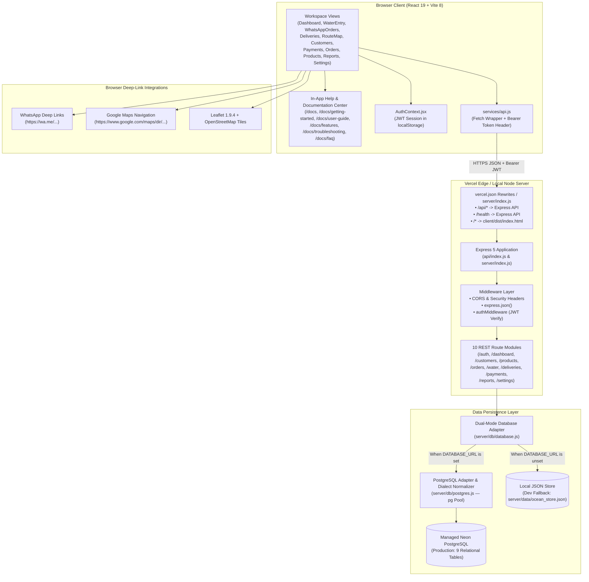
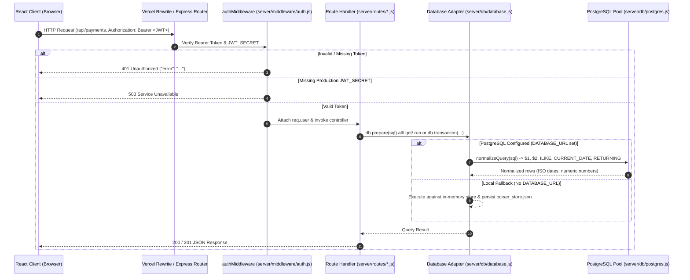

# System Architecture

This document describes the verified technical architecture of the **Ocean Enterprises Business Management System**, including component boundaries, request routing, authentication flow, and database persistence.

---

## 1. High-Level Architecture Diagram

---

## 2. Frontend Architecture (`client/`)

### 2.1 Application Entry & State Routing
- **Entry Point**: [`client/src/main.jsx`](../client/src/main.jsx) mounts [`client/src/App.jsx`](../client/src/App.jsx) inside `#root` in [`client/index.html`](../client/index.html).
- **Routing Strategy**:
  - **Workspace Tab Routing**: Inside the authenticated application, [`App.jsx`](../client/src/App.jsx) manages `activeTab` state (`'dashboard'`, `'water'`, `'whatsapp'`, `'deliveries'`, `'route'`, `'customers'`, `'payments'`, `'orders'`, `'products'`, `'reports'`, `'settings'`, `'docs'`). This keeps tab switches instantaneous without full page reloads.
  - **URL-Synced Documentation Center (`/docs`)**:
    - When the browser URL path starts with `/docs` (e.g., `/docs`, `/docs/getting-started`, `/docs/user-guide`, `/docs/features`, `/docs/troubleshooting`, `/docs/faq`), [`App.jsx`](../client/src/App.jsx) synchronizes with `window.location.pathname` and the History API (`pushState` / `popstate`).
    - Unauthenticated visitors who open `/docs` (or click **Help & Documentation** on the Sign-In page) can read the public Help Center directly and return to the Sign-In page at any time.
    - Authenticated operators who click **Help & Docs** in the sidebar view the Help Center inside the workspace shell with subroute URL synchronization.

### 2.2 API Service Layer (`client/src/services/api.js`)
- Centralizes all HTTP communication under `/api/*`.
- Automatically attaches `Authorization: Bearer <ocean_token>` from `localStorage`.
- Intercepts `401 Unauthorized` responses, clears expired tokens from `localStorage`, and dispatches the custom `ocean_auth_change` window event so [`AuthContext.jsx`](../client/src/context/AuthContext.jsx) immediately transitions back to [`Login.jsx`](../client/src/pages/Login.jsx).

### 2.3 Client Utilities (`client/src/utils/`)
- [`whatsapp.js`](../client/src/utils/whatsapp.js): Normalizes 10-digit Indian mobile numbers with country code `91` and formats message templates (`sendOrderConfirmation`, `sendDeliveryNotification`, `sendOrderDelivered`, `sendPaymentReminder`, `generateOrderCatalogLink`) for `https://wa.me/`.
- [`maps.js`](../client/src/utils/maps.js): Constructs Google Maps directions URLs (`openGoogleMapsNavigation`), pin search URLs (`openGoogleMapsPin`), and wraps HTML5 `navigator.geolocation.getCurrentPosition` (`captureCurrentLocation`).
- [`export.js`](../client/src/utils/export.js): Generates RFC-4180-compatible CSV blobs (`exportToCSV`) and opens styled print windows (`printStatement`).

---

## 3. Backend Architecture (`server/` & `api/`)

### 3.1 Dual Entry Points for Local and Serverless Execution
The backend shares the exact same middleware, route modules, and database adapter across two entry points:

1. **Vercel Serverless Entry Point ([`api/index.js`](../api/index.js))**:
   - Exported as an Express 5 `app` handler (`module.exports = app`) for Vercel Functions.
   - Mounts all 10 route modules under both `/api/<module>` and `/<module>` to support any Vercel rewrite configuration seamlessly.
   - Exposes `GET /api/health` and `GET /health` with live PostgreSQL connection probing (`postgres.testConnection()`).
   - Sets security headers (`X-Content-Type-Options: nosniff`, `X-Frame-Options: SAMEORIGIN`, `Referrer-Policy: strict-origin-when-cross-origin`, and `app.disable('x-powered-by')`).
2. **Standalone Node.js Server ([`server/index.js`](../server/index.js))**:
   - Used for local development (`npm start`) and self-hosted Node.js deployments.
   - Mounts all 10 route modules under `/api/<module>`, serves static frontend build files from `client/dist`, and falls back to `client/dist/index.html` for client-side SPA routes.
   - On startup, automatically runs `postgres.runMigrations()` if `DATABASE_URL` is configured.

### 3.2 Request Lifecycle Sequence

---

## 4. Database Adapter & SQL Normalization Architecture

A key architectural design in Ocean Enterprises is the unified synchronous-style statement builder (`db.prepare(sql)`) in [`server/db/database.js`](../server/db/database.js) paired with [`server/db/postgres.js`](../server/db/postgres.js):

1. **Unified Route Code**: Route handlers write standard parameterized SQL queries (`SELECT ... WHERE id = ?`) and `await db.prepare(sql).get(...)`, `.all(...)`, `.run(...)`, or `await db.transaction(async (tx) => { ... })`.
2. **Automatic Dialect Translation (`normalizeQuery`)**: When `DATABASE_URL` (or `POSTGRES_URL`) is configured, [`server/db/postgres.js`](../server/db/postgres.js) translates SQLite-style constructs into native PostgreSQL:
   - Positional `?` placeholders -> `$1, $2, $3...`
   - `LIKE` -> `ILIKE` (case-insensitive matching)
   - `MAX(0, expr)` -> `GREATEST(0, expr)`
   - `date('now')` / `date(now())` -> `CURRENT_DATE`
   - `datetime('now')` -> `CURRENT_TIMESTAMP`
   - `strftime('%Y-%m', col)` -> `TO_CHAR(col, 'YYYY-MM')`
   - `INSERT OR REPLACE INTO business_settings ...` -> `INSERT INTO business_settings ... ON CONFLICT (key) DO UPDATE SET value = EXCLUDED.value`
   - Appends `RETURNING id` (or `RETURNING key` for `business_settings`) to `INSERT` statements so `result.lastInsertRowid` works identically across both engines.
3. **Type Normalization**:
   - PostgreSQL `DATE` (`OID 1082`) is preserved as `'YYYY-MM-DD'` strings.
   - PostgreSQL `NUMERIC` (`OID 1700`) and `INT8` (`OID 20`) are parsed into JavaScript `Number` values.
   - `TIMESTAMPTZ` `Date` instances are serialized to ISO-8601 strings via `normalizeRow()`.

---

## 5. Vercel Hosting & Routing Topology

In [`vercel.json`](../vercel.json):
- `buildCommand`: `"npm run build"` (installs `client/` packages and runs `vite build`).
- `outputDirectory`: `"client/dist"`.
- `rewrites`:
  1. `{ "source": "/api/(.*)", "destination": "/api" }` — Routes all `/api/*` calls to the serverless Express app in [`api/index.js`](../api/index.js).
  2. `{ "source": "/health", "destination": "/api" }` — Routes `/health` directly to the serverless health endpoint.
  3. `{ "source": "/(.*)", "destination": "/index.html" }` — Serves the React SPA for `/`, `/login`, `/dashboard`, `/orders`, `/docs`, and all `/docs/*` subroutes.

